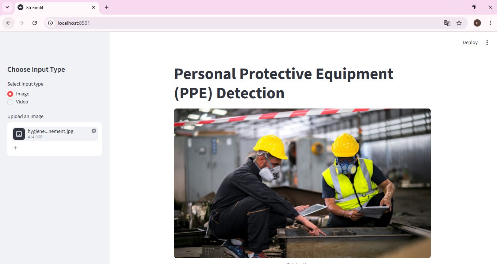
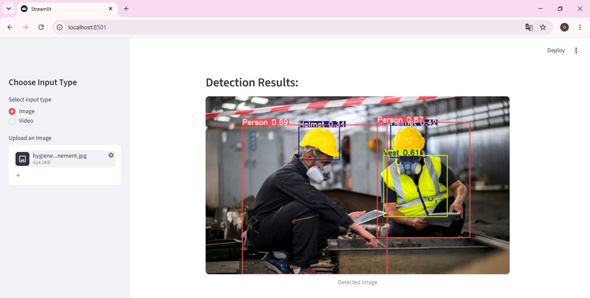

# Personal Protective Equipment (PPE) Detector

**Author** : Oumaima Bendjaj

Real-time **Personal Protective Equipment (PPE) detection** built with **YOLO11** and a **Streamlit** web interface. Upload an image or a video and the app detects whether workers are wearing their safety equipment (helmet, vest, gloves, mask, glasses, boots, ear protection).

## 📸 Demo
###  Upload an image
 

 
### Detection results
 

## ✨ Features

- Detection of **8 classes**: `Boots`, `Ear-protection`, `Glass`, `Glove`, `Helmet`, `Mask`, `Person`, `Vest`
- **Image** and **video** input
- Bounding boxes with class names and confidence scores
- Table of detected objects (coordinates, confidence, class)
- Download of the annotated image or processed video
- Custom YOLO11n model trained on a PPE dataset

## 🧰 Tech Stack

- [Ultralytics YOLO11](https://docs.ultralytics.com/)
- [Streamlit](https://streamlit.io/)
- OpenCV
- Pillow
- Python 3.10+

## ⚙️ How It Works

1. **Input:** the user uploads an image or a video through the Streamlit interface.
2. **Detection:** the custom YOLO11n model (`best.pt`) analyzes the image, or each frame of the video.
3. **Annotation:** bounding boxes, class names and confidence scores are drawn on the result.
4. **Output:** the annotated image or video is displayed, together with a table of detected objects, and can be downloaded.

## 🖥️ How to Use

1. Choose **Image** or **Video** in the sidebar.
2. Upload your file.
3. View the detections and the table of detected objects.
4. Download the annotated result.

## 🏗️ Use Cases

- Safety monitoring on construction sites and in factories
- Automatic checks of PPE compliance at site entrances
- Review of CCTV or inspection footage
- Support for safety audits and training

